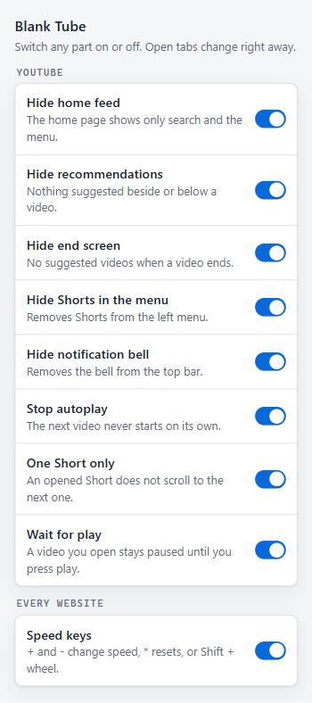

# Blank Tube

Watch the YouTube video you came for, without the feed, recommendations and autoplay pulling you into the next one.

- YouTube opens to a blank page with just the search bar.
- No recommendations beside a video, no suggested videos at the end, no autoplay.
- Every feature has its own on/off switch in the toolbar.
- Also: speed keys for videos on any website.

## Install

Free, about two minutes. Works in Chrome, Edge, Brave and other Chromium browsers.

1. **Download.** At the top of this page, click the green **Code** button, then **Download ZIP**.
   A file called `BlankTube-main.zip` is saved to your Downloads folder.
2. **Unzip it somewhere you'll keep it**, for example your Documents folder.
   - Windows: right-click the file → **Extract All** → **Extract**.
   - Mac: double-click the file.

   Keep this folder. The browser runs the extension from it, so if you delete or move the folder, the extension stops working.
3. **Open the extensions page.** Copy one of these into the address bar and press Enter:
   - Chrome: `chrome://extensions`
   - Edge: `edge://extensions`
   - Brave: `brave://extensions`
4. **Turn on Developer mode.** It's a switch at the top right of the page (in Edge, on the left).
5. **Click Load unpacked.** In the window that opens, go into the folder you unzipped and select the folder
   that has `manifest.json` inside it, then click **Select Folder**.
   On Windows this is often a `BlankTube-main` folder inside another `BlankTube-main` folder.
6. **Pin the button.** Click the puzzle-piece icon next to the address bar, then the pin next to **Blank Tube**.
   This button opens the on/off switches.
7. **Reload YouTube.** Refresh any open YouTube tab. The home page should now be blank apart from the search bar.

Something went wrong?

- **"Manifest file is missing or unreadable":** you chose the wrong folder. Pick the one with `manifest.json` directly inside it.
- **YouTube looks the same:** refresh the YouTube tab, or close it and open YouTube again.
- **The browser warns about developer-mode extensions:** this is normal for extensions installed from a ZIP. Choose to keep it.
- **Still stuck:** paste this page's link into an AI agent such as Claude Code and ask it to walk you through installing the extension.

## Features

All features are on at first. Click the Blank Tube button in the toolbar to switch any of them off.
(If you don't see the button, pin it from the puzzle-piece menu.)

| Feature | What you get |
|---|---|
| Hide home feed | YouTube's home page shows only search and the menu. |
| Hide recommendations | Nothing suggested beside or below the video you're watching. |
| Hide end screen | No suggested-video tiles, end cards or "Up next" card when a video ends. |
| Hide Shorts in the menu | No Shorts link in the left menu. |
| Hide notification bell | No bell in the top bar. |
| Stop autoplay | The next video never starts on its own. Your own playlists still play in order. |
| One Short only | A Short you open stays on screen; scrolling doesn't move to the next one. |
| Wait for play | A video you open (also in a new tab) stays paused until you press play. |
| Speed keys (any website) | Change the speed of any video with the keyboard or mouse wheel. |

### Speed keys

| Do this | Speed |
|---|---|
| `+` (or `=`) | 0.25 faster |
| `-` | 0.25 slower |
| `*` | back to 1x |
| Shift + mouse wheel over the video | up: faster, down: slower |

Speed goes from 0.25x to 16x and carries over to the next video. A small label on the video shows it for a second.
The keys do nothing while you type, or when no video is in view.

Privacy and permissions

Blank Tube collects nothing and sends nothing anywhere. Your switches and your speed are saved in the browser's own
extension storage. See [PRIVACY.md](PRIVACY.md).

When you install it, the browser says it can "read and change all your data on all websites".
That is only because the speed keys work on videos on every site. Everything else runs on YouTube only.

Update or remove

- **Update:** download the ZIP again, unzip it, and copy its files over the ones in your Blank Tube folder.
  Then click the reload arrow on the Blank Tube card in `chrome://extensions`. Your switches are kept.
- **Remove:** click **Remove** on the Blank Tube card.

How it works

| File | Job |
|---|---|
| `features.js` | The list of features and their panel text. Add a feature here first. |
| `settings.js` | Reads the switches. On YouTube it marks `<html>` with `data-ytf-off-<feature>` for each switched-off feature. |
| `popup.html`, `popup.js`, `popup.css` | The switch panel. |
| `focus.css` | Hides parts of YouTube, unless `<html>` carries that part's off mark. |
| `autoplay-off.js` | Stop autoplay. |
| `no-autostart.js` | Wait for play. |
| `shorts-single.js` | One Short only (with two rules in `focus.css`). |
| `speed.js` | Speed keys, on every website. |

`focus.css` hides these parts of YouTube:

| Part | Hidden elements |
|---|---|
| Home feed | `ytd-browse[page-subtype="home"]` grid and topic chips |
| Recommendations | `#related`, `ytd-watch-next-secondary-results-renderer` |
| End screen | `.html5-endscreen`, `.ytp-ce-element`, autoplay countdown, `.ytp-fullscreen-grid` |
| Shorts in the left menu | menu entries whose label is "Shorts" (English YouTube only) |
| Notification bell | `ytd-notification-topbar-button-renderer` |
| Shorts scrolling | `#shorts-container` scrolling is locked; the up/down buttons are hidden |

Playlists and live chat sit in the same column as recommendations and stay visible.

**Stop autoplay** turns off the player's autoplay switch whenever it is on. As a backup, when YouTube's player marks a
video as ended, it presses Cancel on the hidden "Up next" countdown. The player does this a moment before the video
file ends, so the script watches the player, not the file. YouTube-made mixes are stopped; your own playlists are not.

**Wait for play** pauses a video that starts without you. A click on the player or a key press (space, `k`) just before
counts as you pressing play; after that the same video, and its ads, play normally.

**One Short only** blocks the mouse wheel and the arrow / Page Up / Page Down keys on Shorts pages.
Ctrl + wheel (zoom) and Shift + wheel (speed) still work.

**Speed keys** set the chosen speed again whenever a new video starts, because YouTube resets each video to 1x.
A speed picked from YouTube's own menu (or its `<` `>` keys) is kept instead.

If YouTube renames these elements, the matching feature stops working until its rule is updated.

## License

[MIT](LICENSE)
